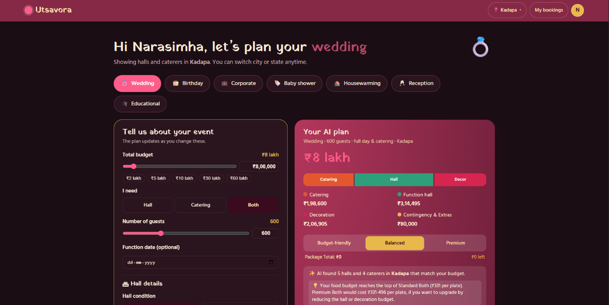
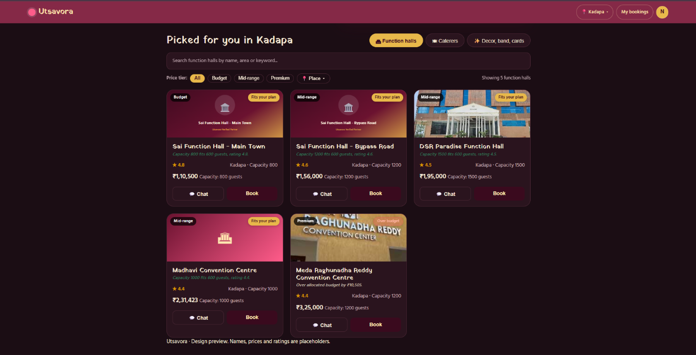
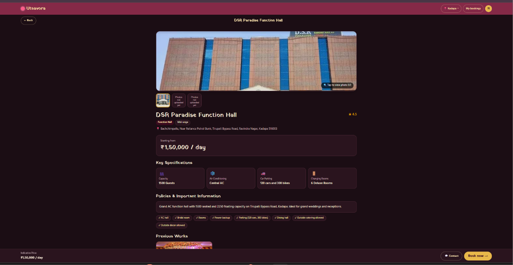
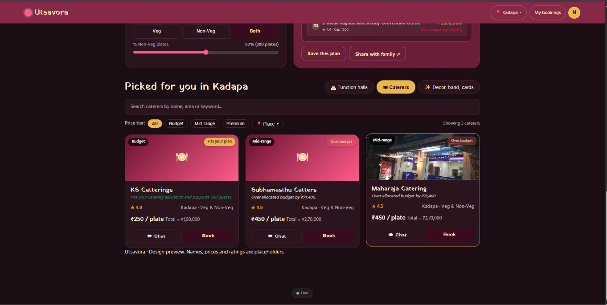
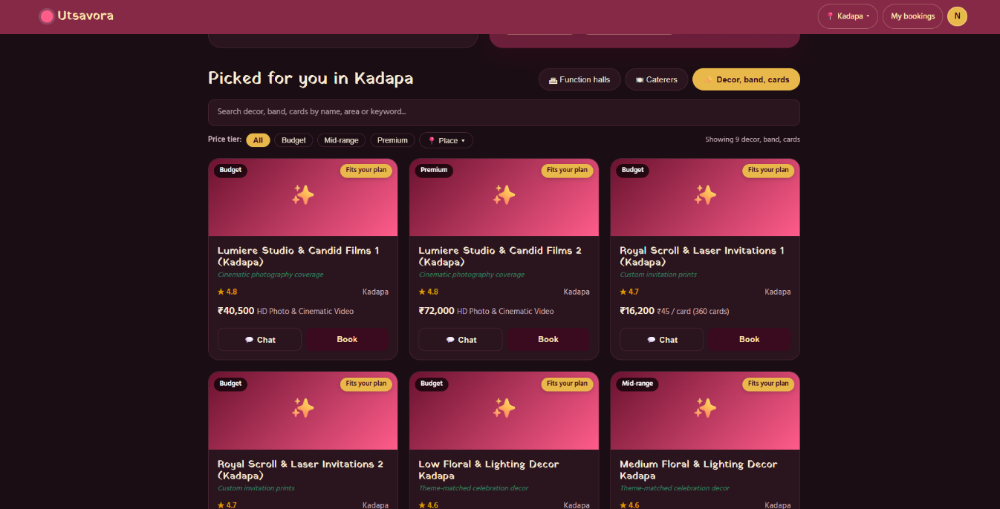
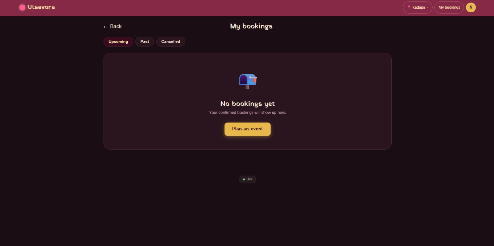
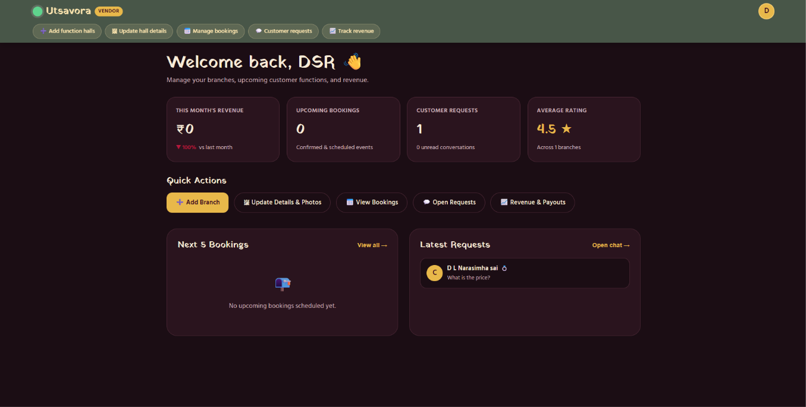

# Utsavora – Event Planning and Service Booking Platform

**Utsavora** is a web-based event planning and service booking platform designed to simplify event management for Indian families. It connects customers with service providers such as function halls, catering services, decorators, bands, and wedding invitation providers through a single platform.

Instead of contacting multiple vendors individually, customers can discover services, compare options, manage bookings, and communicate with vendors in one place.

---

## 🌐 Live Demo

**Live Application:** https://utsavora-9hkr.onrender.com

**GitHub Repository:** https://github.com/Narasimhasai10/Utsavora

---

## 📌 Project Overview

Planning an event traditionally involves contacting multiple service providers, comparing prices, checking availability, and coordinating bookings manually.

This process can be time-consuming and difficult to manage.

Utsavora provides a centralized platform where customers can explore event-related services and vendors can manage their businesses efficiently.

### Main Objectives

- Simplify the event planning process.
- Connect customers with verified service providers.
- Provide a centralized platform for event-related services.
- Improve communication between customers and vendors.
- Make booking and service management easier.
- Support vendors in managing their services and bookings.

---

## ✨ Key Features

### 1. Customer Module
- Customer registration and login.
- Explore available function halls.
- Search and filter services.
- View function hall details, pricing, capacity, and facilities.
- Browse catering packages and other event services.
- Initiate and manage bookings.
- Communicate with vendors through chat.

### 2. Function Hall Management
- Browse available function halls.
- View hall details and facilities.
- Check pricing and capacity information.
- Explore different hall options.

### 3. Catering and Other Services
- Browse catering services.
- Explore catering packages and pricing.
- Discover additional event services such as decoration, bands, and wedding invitations.

### 4. Booking Management
- Customers can initiate bookings.
- Vendors can view and manage booking requests.
- Booking information is maintained through the platform.

### 5. Vendor Dashboard
- Vendor login and dashboard.
- Manage function halls and services.
- View customer booking requests.
- Manage bookings.
- Monitor business-related information.

### 6. Real-Time Communication
- Customer and vendor communication.
- Real-time chat functionality using Socket.IO.

### 7. AI Event Planner
- Event planning assistance.
- Helps users organize event-related requirements through the planner functionality.

### 8. Admin Module
- Admin dashboard.
- Customer and vendor management.
- Vendor document verification.
- Platform administration.

---

## 🛠️ Technology Stack

| Layer | Technologies |
|---|---|
| Frontend | React 18, Vite, JavaScript, CSS |
| Backend | Node.js, Express.js |
| Database | SQLite, PostgreSQL |
| ORM | Prisma ORM |
| Authentication | JWT, bcryptjs |
| Real-Time Communication | Socket.IO |
| Payment Integration | Mock Payment, Razorpay Adapter |
| File Storage | Local Storage, Cloudinary |
| API Documentation | Swagger UI, OpenAPI |
| Security | Helmet, CORS, Express Rate Limit, Zod |
| Background Jobs | node-cron |
| Deployment | Render |
| Version Control | Git, GitHub |

---

## 🏗️ System Architecture

Utsavora follows a client-server architecture.

### 1. Frontend Layer
The frontend is developed using React and Vite. It provides the user interface for customers, vendors, and administrators.

### 2. Backend Layer
The backend is developed using Node.js and Express.js. It handles authentication, service management, booking operations, and API requests.

### 3. Database Layer
Prisma ORM manages database operations. SQLite is used for local development, while PostgreSQL is configured for production deployment.

### 4. Real-Time Communication
Socket.IO enables real-time communication between customers and vendors.

### 5. Cloud Services
Render is used for application hosting, Neon provides hosted PostgreSQL, and Cloudinary supports cloud-based file storage.

---

## 📸 Application Screenshots

The following screenshots demonstrate the main features and interfaces of Utsavora.

### 1. Customer Homepage

The customer homepage provides access to the platform's main features and event-related services.



### 2. Function Hall Listings

Customers can explore available function halls and compare different options.



### 3. Function Hall Details

Displays detailed information about a selected function hall, helping customers understand its facilities and pricing.



### 4. Catering Services

Customers can explore catering services and available food packages.



### 5. Other Event Services

Displays additional event-related services available through the platform.



### 6. My Bookings

Customers can view and manage their booking information.



### 7. Vendor Dashboard

The vendor dashboard allows service providers to manage their business activities and booking information.



---

## 🚀 Installation and Setup

Follow these steps to run Utsavora locally.

### Prerequisites

Make sure the following software is installed:

- Node.js
- npm
- Git
- A code editor such as Visual Studio Code

### Step 1: Clone the Repository

```bash
git clone https://github.com/Narasimhasai10/Utsavora.git
```

### Step 2: Navigate to the Project Directory

```bash
cd Utsavora
```

### Step 3: Install Dependencies and Initialize the Project

```bash
npm run setup
```

This command installs dependencies, initializes the database, runs seed scripts, and builds the standalone application.

### Step 4: Configure Environment Variables

Configure the required environment variables using the provided `.env.example` templates.

Add the appropriate database connection, authentication secrets, and service configuration required for your environment.

Do not upload actual `.env` files or secret credentials to GitHub.

### Step 5: Start the Application

```bash
npm run dev
```

The development environment runs:

- Frontend: `http://localhost:5173`
- Backend: `http://localhost:4000`
- API Documentation: `http://localhost:4000/docs`

---

## 📁 Project Structure

```text
UTSAVORA/
├── frontend/               # React 18 + Vite SPA client
│   ├── src/
│   │   ├── api/            # API client with automatic offline fallback (mock.js)
│   │   ├── components/     # UI screens, modals, planner forms, vendor dashboard
│   │   ├── offline/        # Offline fallback planner and synchronized configs
│   │   ├── services/       # Store, auth, booking, and chat services
│   │   └── utils/          # Location, contact guard, contrast, and verification utilities
│   ├── public/             # Static public assets
│   ├── vite.config.js      # Vite build & proxy configuration (/api -> :4000)
│   └── package.json        # Frontend workspace configuration
│
├── backend/                # Express & Socket.IO REST API (Port 4000)
│   ├── src/
│   │   ├── adapters/       # Masked calls, document verifier, mock payments
│   │   ├── middleware/     # Auth, ContactGuard privacy filter, rate-limits
│   │   ├── routes/         # Auth, vendors, planner, bookings, chat, admin
│   │   ├── services/       # Planner source of truth, pricing, revenue
│   │   └── utils/          # JWT, logger, prisma client, audit logger
│   ├── tests/              # 50 Automated unit & integration tests
│   ├── uploads/            # Masked private documents & public assets (git-ignored)
│   ├── openapi.yaml        # Complete OpenAPI 3.0 specification
│   ├── package.json        # Backend workspace configuration
│   └── .env.example        # Backend environment variables template
│
├── database/               # Database Layer & Prisma ORM
│   ├── schema.prisma       # 29 Relational models, indexes & unique constraints
│   ├── seed.js             # Seeder script for Kadapa vendors, branches, bookings
│   ├── seed-data/          # Master seed catalogs (planner, locations, dummy vendors)
│   ├── migrations/         # Prisma migration history
│   ├── utsavora.db          # SQLite database file (git-ignored)
│   └── README.md           # Database management documentation
│
├── docs/                   # System Documentation
│   ├── ERD.md              # Mermaid diagram of all 29 database models
│   ├── utsavora.http       # REST Client ready-to-run API requests
│   ├── architecture.md     # Full architectural and privacy specification
│   └── screenshots/        # Application screenshots for README
│
├── scripts/                # Workspace Automation & Quality Assurance
│   ├── build-singlefile.mjs    # Inlines assets into self-contained root index.html
│   ├── sync-planner-config.mjs # Copies planner config to frontend offline fallback
│   ├── check.mjs               # Workspace integrity & hygiene auditor
│   ├── db-check.mjs            # Validates database connection & counts
│   ├── db-reset.mjs             # Resets and re-seeds SQLite database cleanly
│   ├── db-backup.mjs            # Creates timestamped backup of database/utsavora.db
│   ├── dev.mjs                 # Cross-platform parallel dev runner (:4000 + :5173)
│   ├── setup.mjs               # One-click workspace initialization script
│   └── e2e-verification.mjs    # Regression & verification suite
│
├── index.html              # GENERATED single-file standalone app (file:// compatible)
├── package.json            # Root workspace orchestration scripts
├── .gitignore              # Clean gitignore (UTF-8, LF, zero tracked leaks)
└── .env.example            # Root environment variables template
```

---

## ⚙️ Available Commands

The following commands are available in the root directory.

| Command | Description |
| :--- | :--- |
| `npm run setup` | Installs dependencies, initializes database, runs seeds, builds standalone app |
| `npm run dev` | Runs backend (:4000) with Swagger `/docs` and frontend (:5173) together |
| `npm run build` | Builds frontend production assets |
| `npm run build:standalone` | Compiles zero-CORS single-file `index.html` for offline double-click use |
| `npm start` | Runs backend serving both the REST API and the bundled web application |
| `npm test` | Runs the full 80-test automated suite (backend + frontend) |
| `npm run check` | Audits workspace hygiene, stray HTML files, duplicate CSS, and script tags |
| `npm run db:check` | Verifies database connection and reports model row counts |
| `npm run db:reset` | Wipes, pushes schema, and re-seeds `database/utsavora.db` |
| `npm run db:backup` | Saves a backup copy to `database/backups/` |

---

## 🌍 Deployment

Utsavora is configured for deployment using Render.

The deployment setup uses:

- **Render:** Application hosting.
- **Neon:** Hosted PostgreSQL database.
- **Cloudinary:** Cloud-based file storage.

The production environment requires the appropriate environment variables and service configurations.

The project also supports generating a standalone frontend application using:

```bash
npm run build:standalone
```

This generates a single-file `index.html` that can be opened directly in a browser.

**Note:** The standalone frontend supports offline/demo functionality where implemented. Features that depend on the backend, database, cloud storage, payments, or real-time communication require their corresponding services to be available.

---

## 🔐 Security and Reliability

Utsavora includes several security and reliability mechanisms:

- JWT-based authentication.
- Password hashing using bcryptjs.
- Protected backend routes.
- Rate limiting for API requests.
- Security headers using Helmet.
- Input validation using Zod.
- CORS configuration.
- Privacy-related middleware.
- Audit logging.
- Database constraints and relationships.
- Background jobs for booking-related operations.

Sensitive environment variables and private documents should not be committed to the public repository.

---

## 👥 Team Members and Contributions

Utsavora was developed collaboratively by a team of six members.

| Team Member | Responsibility |
|---|---|
| KETHAMALLA VEERA CHANIKYA | Team Leadership, Project Coordination and Deployment |
| DHAKONDA AMMULU | Database Management and Login Functionality |
| BODDU SRIRAM RATNA KUMAR | AI Planner and Backend Development |
| DANDE LENANDAN NARASIMHA SAI | Customer Homepage and Frontend Development |
| DHAVALA HANSHITHA | Chat Functionality and Booking Management |
| NAKKALA HEMA VARSHINI | Vendor Portal Development |

---

## 🔮 Future Enhancements

Some possible future improvements include:

- Advanced event budget estimation.
- More personalized event planning recommendations.
- Additional payment gateway integrations.
- Improved vendor analytics and reports.
- More event service categories.
- Enhanced search and filtering.
- Mobile application support.
- Improved notification and booking tracking features.

---

## 📚 Project Links

| Resource | Link |
|---|---|
| Live Application | https://utsavora-9hkr.onrender.com |
| GitHub Repository | https://github.com/Narasimhasai10/Utsavora |

---

## 📝 Project Summary

Utsavora aims to make event planning easier by bringing customers and event service providers together on a single digital platform.

By combining service discovery, booking management, vendor dashboards, communication features, and event planning assistance, the platform provides a centralized solution for managing event-related requirements.

**Utsavora – Plan Better. Celebrate Better.**
